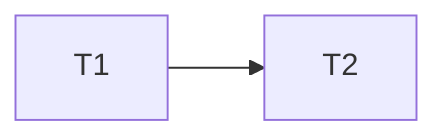
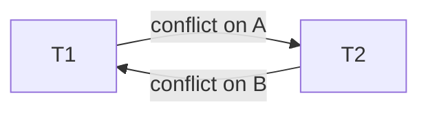

# DBMS Theory Notes

Short notes that connect the syllabus to the project. Each section says where to find the
matching code.

---

## 1. MySQL stored programs vs Oracle PL/SQL

Many textbooks and syllabi teach **PL/SQL**, which is Oracle's procedural language. **MySQL does not
support PL/SQL syntax.** MySQL has its own procedural SQL (called *stored programs*). The *ideas* are
the same; the *syntax* is different. This project uses the MySQL versions.

| Concept | Oracle PL/SQL | MySQL equivalent used here |
|---|---|---|
| Block structure | `DECLARE ... BEGIN ... EXCEPTION ... END;` | `BEGIN ... END` with `DECLARE` at the top and handlers declared inside |
| Procedure | `CREATE PROCEDURE p (x IN NUMBER) IS ...` | `CREATE PROCEDURE p (IN x INT) BEGIN ... END` |
| Function | `CREATE FUNCTION f RETURN VARCHAR2 IS ...` | `CREATE FUNCTION f(...) RETURNS VARCHAR(10) ... BEGIN ... RETURN ...; END` |
| Variables | `v_name VARCHAR2(50);` | `DECLARE v_name VARCHAR(50);` |
| Cursor | `CURSOR c IS SELECT ...; FETCH c INTO ...; EXIT WHEN c%NOTFOUND;` | `DECLARE c CURSOR FOR SELECT ...; FETCH c INTO ...;` plus `DECLARE CONTINUE HANDLER FOR NOT FOUND` |
| Exception handling | `EXCEPTION WHEN DUP_VAL_ON_INDEX THEN ...` | `DECLARE EXIT HANDLER FOR 1062 ...` (error numbers / SQLSTATE) |
| Raise an error | `RAISE_APPLICATION_ERROR(-20001, 'msg');` | `SIGNAL SQLSTATE '45000' SET MESSAGE_TEXT = 'msg';` |
| Trigger | `CREATE TRIGGER ... BEFORE/AFTER INSERT ... FOR EACH ROW` with `:NEW.col` | `CREATE TRIGGER ... AFTER INSERT ON t FOR EACH ROW` with `NEW.col` |
| Packages | supported | **not supported** |
| Statement end | `/` runs the block | `DELIMITER $$` is needed in the mysql client |

Where in the project: `database/stored_programs.sql`.

### What each stored program does

| Program | Type | Purpose | Key idea shown |
|---|---|---|---|
| `AddMember` | procedure | Inserts a member | IN parameters, exit handler for duplicate email, `SIGNAL` |
| `AssignMembership` | procedure | Adds a membership and calculates `end_date = start_date + plan duration` | local variable, `SELECT ... INTO`, `IF`, `SIGNAL`, handler for FK error |
| `GetMembershipStatus` | function | Returns `Active` / `Expired` from dates and status | `RETURNS`, `READS SQL DATA`, `IF/ELSEIF`, used inside a `SELECT` |
| `ShowExpiringMemberships` | procedure with cursor | Lists memberships ending in the next 7 days | cursor: `DECLARE`, `OPEN`, `FETCH` loop, `CLOSE`, `NOT FOUND` handler |
| `AfterAttendanceInsert` | trigger | Adds 1 to `Members.total_visits` after each check-in | `AFTER INSERT`, `NEW.member_id` |
| `AssignAndPay` (in `transactions.sql`) | procedure | Membership + payment saved together | transaction inside a procedure, `ROLLBACK` in a handler |

**Procedure vs function:** a procedure is run with `CALL` and may return result sets or change data;
a function returns exactly one value and can be used inside a query (`SELECT GetMembershipStatus(id)`).

---

## 2. Exception handling in MySQL

An *exception* is an error raised while a program runs. MySQL lets you catch it with a **handler**.

```sql
DECLARE EXIT HANDLER FOR 1062          -- the condition to catch
    SIGNAL SQLSTATE '45000'            -- the action to run
    SET MESSAGE_TEXT = 'Email already registered';
```

- **Handler type**
  - `EXIT`: run the action, then leave the current `BEGIN ... END` block (used for errors).
  - `CONTINUE`: run the action, then carry on with the next statement (used for the cursor's `NOT FOUND`).
- **Condition** (what to catch): a MySQL error number (`1062` duplicate, `1452` foreign key),
  an SQLSTATE value, or a class: `SQLEXCEPTION` (any error), `SQLWARNING`, `NOT FOUND` (no more rows).
- **`SIGNAL`** raises your own error. `SQLSTATE '45000'` means "unhandled user-defined exception"; the text goes in
  `MESSAGE_TEXT`. The client sees it as error **1644**, which the Flask app displays in a red alert.
- **`RESIGNAL`** re-raises the error currently being handled (not needed in this project).

Examples in the project

| Situation | Where | Result |
|---|---|---|
| Duplicate email | `AddMember` (handler for 1062) | "Email already registered" |
| Unknown plan | `AssignMembership` (`IF ... SIGNAL`) | "Plan does not exist" |
| Unknown member | `AssignMembership` (handler for 1452) | "Member does not exist" |
| Any error inside a payment transaction | `AssignAndPay` (handler for `SQLEXCEPTION`) | `ROLLBACK`, nothing saved |

---

## 3. Constraints vs triggers

| | Constraint | Trigger |
|---|---|---|
| Purpose | Declare a rule the data must obey | Run extra actions when data changes |
| Style | Declarative ("this must be true") | Procedural (code that runs) |
| Can reject bad data? | Yes (automatically) | Yes, with `SIGNAL`, but more work |
| Can update other tables? | No | Yes |
| Examples here | `CHECK (amount > 0)`, `UNIQUE (member_id, attendance_date)`, FOREIGN KEY | `AfterAttendanceInsert` updates `Members.total_visits` |

Rule of thumb used in this project: **if a constraint can express the rule, use the constraint;
use a trigger only for actions a constraint cannot do.** That is why "no negative payments" and
"one check-in per day" are constraints, and only the counter update is a trigger. The same rule is
never implemented twice.

---

## 4. Transactions and ACID

A **transaction** is a group of SQL statements treated as one unit of work.
MySQL's InnoDB engine supports transactions (the old MyISAM engine does not).

```sql
START TRANSACTION;   -- begin
...statements...
COMMIT;              -- save everything permanently
-- or
ROLLBACK;            -- undo everything since START TRANSACTION
SAVEPOINT name;      -- bookmark; ROLLBACK TO SAVEPOINT name undoes only later work
```

| Property | Meaning | Project example |
|---|---|---|
| **Atomicity** | all or nothing | `AssignAndPay` saves membership + payment together or neither |
| **Consistency** | database moves from one valid state to another | constraints reject a payment of -500 |
| **Isolation** | concurrent transactions do not interfere | a second session waits for a locked row (see `transactions.sql`, Part 7) |
| **Durability** | committed data survives a crash | InnoDB redo log (write-ahead logging) |

Where in the project: `database/transactions.sql`.

---

## 5. Schedules, serializability and the precedence graph

A **schedule** is the order in which operations from several transactions are executed.

- **Serial schedule:** one transaction runs completely before the next starts. Always correct, but no overlap.
- **Concurrent (interleaved) schedule:** operations of different transactions are mixed to improve speed.
  It is acceptable only if its result equals that of some serial schedule (it is **serializable**).
- **Conflicting operations:** two operations from *different* transactions on the *same data item*, where *at least
  one is a write* (read-write, write-read, write-write).
- **Conflict serializable:** the schedule can be turned into a serial schedule by swapping only non-conflicting operations.

**Precedence (serialization) graph test:** one node per transaction; draw an edge `Ti -> Tj` if an operation of Ti
conflicts with a *later* operation of Tj. **No cycle = conflict serializable.**

The worked example (items A and B are the prices of plan 1 and plan 2; T1 adds 100 to both, T2 doubles both) is in
`transactions.sql`, Part 6.

Schedule **S1**  `R1(A) W1(A) R2(A) W2(A) R1(B) W1(B) R2(B) W2(B)`: only edges `T1 -> T2`.



No cycle, so S1 is conflict serializable and equivalent to the serial order T1, T2.

Schedule **S2**  `R1(A) W1(A) R2(A) W2(A) R2(B) W2(B) R1(B) W1(B)`: on A, T1 comes first; on B, T2 comes first.



There is a cycle, so S2 is **not** conflict serializable.

---

## 6. Recoverable and cascadeless schedules

These concern what happens when a transaction **aborts**.

- **Recoverable schedule:** if Tj reads a value written by Ti, then Ti must **commit before** Tj commits.
  Otherwise Tj could commit based on data that Ti later rolls back, and that cannot be undone.
  - *Not recoverable:* `W1(A) R2(A) C2 ... A1`. T2 committed after reading T1's uncommitted write, and then T1 aborted.
  - *Recoverable:* `W1(A) R2(A) C1 C2`.
- **Cascading rollback:** if T1 aborts, every transaction that read T1's dirty data must also abort, and so on down the
  chain. This wastes work.
- **Cascadeless (ACA) schedule:** a transaction may read an item only **after** the transaction that wrote it has
  committed. No dirty reads, so no cascading rollbacks. Every cascadeless schedule is recoverable; the reverse is not true.
- **Strict schedule:** nobody may even *read or overwrite* an item until the writer commits or aborts. This is the
  easiest to recover from; InnoDB's row locks held until `COMMIT` give strict behaviour for writes.

---

## 7. Deadlocks and the wait-die / wound-wait schemes

A **deadlock** happens when transactions wait for each other in a circle, so none can continue.

```
T1 holds lock on row 1, wants row 2
T2 holds lock on row 2, wants row 1      -> both wait forever
```

(The two-session demo is in `transactions.sql`, Part 7c.)

Handling deadlocks:

1. **Prevention** - make a cycle impossible, e.g. lock rows in a fixed order, or use timestamp schemes.
2. **Detection and recovery** - allow deadlocks, find them with a *wait-for graph* (a cycle means deadlock),
   and abort one *victim* transaction. **InnoDB does this**: it detects the cycle immediately and rolls back one
   transaction with error 1213.
3. **Timeout** - give up waiting after a set time (`innodb_lock_wait_timeout`, error 1205).

**Timestamp-based prevention.** Every transaction gets a timestamp `TS` when it starts; a smaller number means an
*older* transaction. Suppose Ti requests a lock held by Tj:

| Scheme | If Ti is **older** than Tj (TS(Ti) < TS(Tj)) | If Ti is **younger** than Tj |
|---|---|---|
| **Wait-die** (non-preemptive) | Ti **waits** | Ti **dies** (aborts and restarts with its original timestamp) |
| **Wound-wait** (preemptive) | Ti **wounds** Tj (Tj is aborted and restarts) | Ti **waits** |

- Wait-die: old waits for young; young is never allowed to wait for old.
- Wound-wait: old forces young out of the way; young waits for old.
- In both, waiting always goes in one direction (by age), so a cycle cannot form, and the restarted transaction keeps
  its original timestamp so it eventually becomes the oldest and cannot starve.

---

## 8. Recovery: log-based recovery and shadow paging

Recovery restores the database to a consistent state after a crash, using the *atomicity* and *durability* rules.

### Log-based recovery
The **log** is a sequential file recording every change *before* it reaches the database
(**write-ahead logging, WAL**). Typical records:

```
<T1 start>
<T1, X, old_value, new_value>      -- an update
<T1 commit>   or   <T1 abort>
```

- **Deferred modification:** the database is changed only after the transaction commits. Recovery only needs *redo*.
- **Immediate modification:** the database may be changed before commit. Recovery needs *undo* and *redo*.
- **Checkpoint:** a point where all earlier log records and changes are safely on disk, so recovery need not read the
  entire log.
- **Recovery after a crash:**
  - **REDO** every transaction whose log has both `start` and `commit` (its changes may not have reached disk).
  - **UNDO** every transaction that has `start` but no `commit` (it was unfinished, so cancel it).

InnoDB uses this idea: an **undo log** (to roll back and to give consistent reads) and a **redo log** (to replay committed
changes after a crash).

### Shadow paging
The database is divided into fixed-size pages. Two page tables are kept:

- **Shadow page table:** the old, untouched copy; it always describes a consistent state.
- **Current page table:** used by the running transaction. When a page is changed, the new version is written to a *new*
  disk page and only the current table points to it.

**Commit:** atomically switch the "root pointer" so the current page table becomes the new shadow table.
**Crash / abort:** simply discard the current table; the shadow table still describes the old consistent database.
No undo/redo log is needed.

| | Advantage | Disadvantage |
|---|---|---|
| Shadow paging | fast, simple recovery; no log replay | copying pages is costly; data fragments over time; old pages need garbage collection; hard to support many concurrent transactions |
| Log-based | efficient, supports concurrency | needs log management, checkpoints and redo/undo logic |

*Note:* this project does **not** implement a recovery or concurrency-control engine. InnoDB already does that;
the project only demonstrates its behaviour (`transactions.sql`).

---

## 9. Where each topic appears in the project

| Syllabus topic | Where |
|---|---|
| ER model, keys, relationships | `docs/ER_diagram.md`, `database/schema.sql` |
| Relational schema, constraints | `database/schema.sql`, `docs/ER_diagram.md` |
| Normalization | `docs/normalization.md` |
| SQL (DDL, DML, joins, grouping, subqueries, views, indexes) | `database/queries.sql` |
| Procedures, functions, cursors, triggers, exceptions | `database/stored_programs.sql` |
| Transactions, ACID, savepoints, locking | `database/transactions.sql` |
| Schedules, serializability, recoverability, deadlocks, recovery | this file (sections 5-8) and `transactions.sql` Parts 6-7 |
| Using a DBMS from an application | `app.py` (parameterised queries, procedure calls, error handling) |

*(Your syllabus may group these differently or number the units differently; use this table to point to the right file.)*
