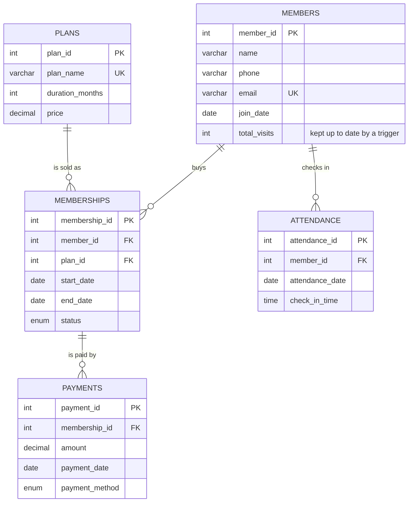

# ER Diagram and Relational Schema

## 1. ER diagram (Mermaid)

Paste this into any Mermaid viewer (GitHub renders it automatically, and so does the
VS Code extension "Markdown Preview Mermaid Support").



How to read the lines: `||--o{` means "exactly one on the left, zero or many on the right".
For example, one member can have zero or many memberships, but each membership belongs to exactly one member.

## 2. Relationships

| Relationship | Type | Explanation |
|---|---|---|
| Members - Memberships | one-to-many (1 : N) | A member can buy many memberships over time (e.g. Monthly, then Annual). Each membership belongs to one member. |
| Plans - Memberships | one-to-many (1 : N) | A plan (e.g. Quarterly) is bought in many memberships. Each membership uses one plan. |
| Memberships - Payments | one-to-many (1 : N) | A membership can be paid in several payments (instalments). Each payment belongs to one membership. |
| Members - Attendance | one-to-many (1 : N) | A member checks in many times. Each check-in belongs to one member. |
| **Members - Plans** | **many-to-many (M : N)** | A member can use many plans and a plan is used by many members. A many-to-many relationship cannot be stored directly in a relational database, so it is resolved by the **associative (bridge) table Memberships**, which also carries its own attributes (start_date, end_date, status). |

## 3. Relational schema

Primary keys are marked `PK`, foreign keys are marked `FK`.

```
Members     (member_id PK, name, phone, email UNIQUE, join_date, total_visits)
Plans       (plan_id PK, plan_name UNIQUE, duration_months, price)
Memberships (membership_id PK, member_id FK -> Members, plan_id FK -> Plans,
             start_date, end_date, status)
Payments    (payment_id PK, membership_id FK -> Memberships, amount,
             payment_date, payment_method)
Attendance  (attendance_id PK, member_id FK -> Members, attendance_date,
             check_in_time, UNIQUE(member_id, attendance_date))
```

## 4. Keys explained

| Table | Primary key | Foreign keys | Other keys / candidate keys |
|---|---|---|---|
| Members | `member_id` (auto-increment surrogate key) | none | `email` is UNIQUE, so it is a **candidate key** that was not chosen as the primary key (emails can change; an id never does). |
| Plans | `plan_id` | none | `plan_name` is UNIQUE (candidate key). |
| Memberships | `membership_id` | `member_id` -> Members, `plan_id` -> Plans | - |
| Payments | `payment_id` | `membership_id` -> Memberships | - |
| Attendance | `attendance_id` | `member_id` -> Members | `(member_id, attendance_date)` is UNIQUE: a **composite candidate key** that allows one check-in per member per day. |

**Primary key** = uniquely identifies a row, never NULL, one per table.
**Foreign key** = a column that holds the primary key value of another table; it guarantees
*referential integrity* (you cannot create a membership for a member that does not exist).
All foreign keys use the default `RESTRICT` rule, so a member or plan that is still referenced
cannot be deleted. The application shows a friendly message when that happens.

## 5. Constraints used

| Constraint | Where | What it prevents |
|---|---|---|
| PRIMARY KEY | every table | duplicate or missing row identifiers |
| FOREIGN KEY | Memberships, Payments, Attendance | rows pointing at records that do not exist |
| NOT NULL | all columns | missing data |
| UNIQUE | `Members.email`, `Plans.plan_name`, `Attendance(member_id, attendance_date)` | duplicate emails, duplicate plan names, two check-ins in one day |
| CHECK | `Plans.price > 0`, `Plans.duration_months > 0`, `Payments.amount > 0`, `Memberships.end_date >= start_date` | zero/negative money and impossible date ranges |
| DEFAULT | `Members.total_visits = 0`, `Memberships.status = 'Active'` | forgetting to supply a starting value |
| ENUM | `Memberships.status`, `Payments.payment_method` | values outside the allowed list |
